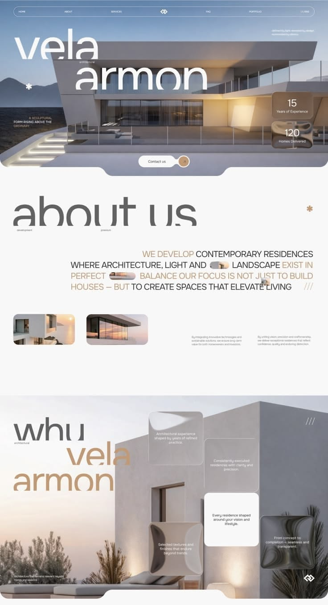

# ARCA TERRA — Arquitectura Residencial Premium

Landing page de alta gama para despacho de arquitectura contemporánea, diseñada con dirección de arte editorial, minimalista y refinada.



## 🏛️ Características y Dirección de Arte

- **Diseño Editorial & Minimalista**: Paleta neutra de grises profundos, titanio y blancos arquitectónicos, inspirada en las principales firmas residenciales globales.
- **Tipografía de Lujo**:
  - Encabezados: **Syne** (Geométrica, moderna y distintiva).
  - Cuerpos de texto: **SF Pro Display / Text** (Legibilidad y sofisticación editorial).
- **Glassmorphism & Micro-interacciones**:
  - Tarjetas flotantes con efecto esmerilado (`backdrop-filter: blur`), bisel exterior y specular highlight dinámico.
  - Botón principal de contacto con curvatura inversa arquitectónica SVG.
  - Efecto de inclinación 3D interactivo (`tilt`) con cálculo de perspectiva en tiempo real.
- **Responsive Adaptativo**:
  - Optimización milimétrica para dispositivos móviles (iOS / Android) y pantallas de escritorio 4K.
  - Menú de navegación flotante con drawer móvil y desenfoque progresivo.
- **Secciones Integradas**:
  - **Hero**: Escultórico, estadísticas clave y CTA directo.
  - **Nosotros**: Manifiesto arquitectónico con micro-imágenes tipográficas.
  - **Por Qué Elegirnos**: Grid de tarjetas flotantes con acabados materiales y especificaciones.
  - **Portafolio**: Galería inmersiva de residencias exclusivas.
  - **Servicios**: Diseño arquitectónico integral, construcción y dirección de obra, interiorismo de autor.
  - **Contacto**: Formulario con validación y enlace directo al canal prioritario de WhatsApp.

## 🛠️ Tecnologías

- **HTML5 Semántico**: Estructura accesible y optimizada para SEO.
- **CSS3 Moderno**: Variables CSS (tokens de diseño), Flexbox, CSS Grid, Glassmorphism, animaciones fluidas por aceleración de hardware.
- **JavaScript Vanilla (ES6+)**: Control de scroll parallax, animaciones de entrada IntersectionObserver, interactividad móvil sin dependencias externas pesadas.

## 🚀 Despliegue Local

Simplemente abre el archivo `index.html` en cualquier navegador web moderno o utiliza una extensión de servidor local como *Live Server*:

```bash
# Con npx serve o similar
npx serve .
```

---
Diseñado y desarrollado para **ARCA TERRA Arquitectura**.
